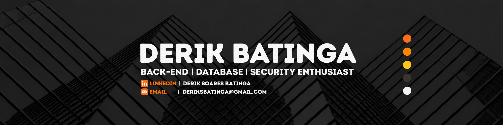

<!--
Readme inspirado nos seguintes githubs
Total créditos a eles:
https://github.com/AntonioSena0
https://github.com/asapnyell 
-->

<b>English Version</b>

# Hello, I'm Derik Batinga! 👋

### 👨‍💻 Aspiring Back-end Developer | Systems Development Student

I'm a technical high school student pursuing a qualification in Systems Development at ETEC da Zona Leste, Brazil.

I'm passionate about programming and enjoy exploring different fields, including engine engineering, embedded systems and astrology.

My main focus is back-end development, particularly Java, Spring Boot, and databases. I'm currently looking for an internship or apprenticeship opportunity where I can apply and enhance my knowledge,

---

### 🎯 Professional Goal
I'm looking for internship opportunity or a position as a young apprentice to apply and expand my knowledge in Java, Spring Boot, Docker and Database.

---

### 🛠 Technologies and Tools

#### 🚀 Programming languages
<!--  -->

<!--  -->

#### 💾 Databases

<!-- 

 -->

#### 📦 Tools

#### 🐧 Operating Systems

### 📚 Currently studying

- ☕ Back-end development with **Java + Spring Boot**
- 🗄️ **SQL e NoSQL** databases
- 📦 How to use **Docker** beyond the basics
- 🐙 **Git** for version control
- 👨‍🔧 Software Architecture

---

### 📫 Contact

---

<b>Portuguese Version</b>

---

# Olá, me chamo Derik Batinga! 👋

### 👨‍💻 Back-end Developer | Cursando em Desenvolvimento de Sistemas

Olá, me chamo Derik, sou estudante do Ensino Médio técnico em DS na Etec da Zona Leste, buscando oportunidade de estágio ou jovem aprendiz para aplicar e expandir meus conhecimentos em Java, Spring Boot, Docker e Banco de Dados.

Gosto de estudar multiplas áreas, como engenharia de motores, astrologia e Sistemas Embarcalos, isso sem contar minha paixão por programação.

---

### 🎯 Objetivo Profissional
Estou em busca da minha primeira oportunidade como **Desenvolvedor Back-end Java**, pronto para aprender e somar com minha dedicação e competências em projetos reais.

---

### 🛠 Tecnologias e Ferramentas

#### 🚀 Linguagens de Programação
<!--  -->

<!--  -->

#### 💾 Banco de Dados

<!-- 

 -->

#### 📦 Ferramentas

#### 🐧 Sistemas Operacionais

### 📚 Atualmente Estudando

- ☕ Desenvolvimento Backend com **Java + Spring Boot**
- 🗄️ Banco de Dados **SQL e NoSQL**
- 📦 Como utilizar **Docker** além do básico
- 🐙 **Git** para versionamento
- 👨‍🔧 Arquitetura de Sistemas

---

### 📫 Contato

---

